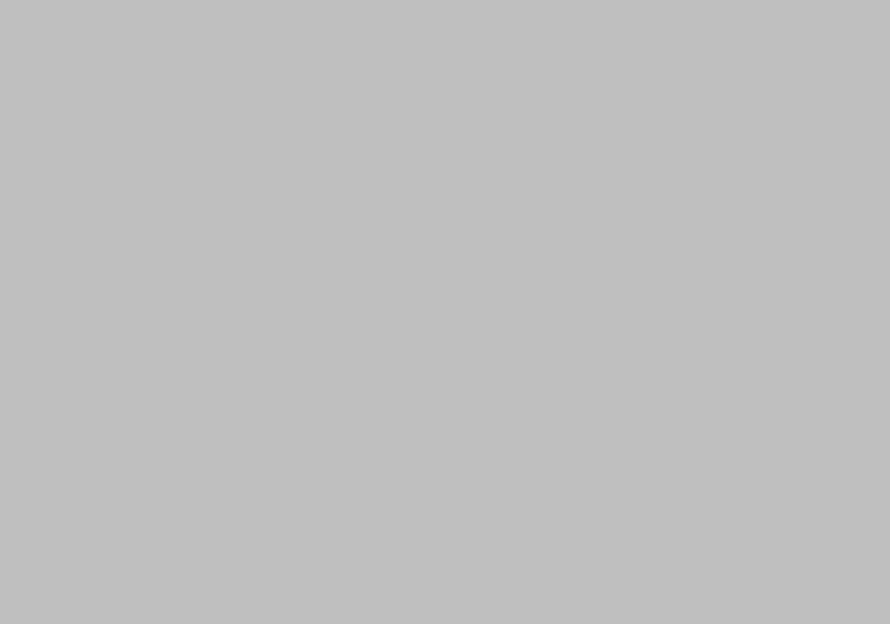

# tex-writer-studio

A simple LaTeX editor and PDF compiler with live source-to-document navigation.



## 1. Installing

To install the package from [PyPI](https://pypi.org/project/tex_writer_studio/), follow the instructions below:


### With pip

```bash
pip install --upgrade tex_writer_studio
```

Execute `which tex-writer-studio` to see where it was installed, probably in `/home/USERNAME/.local/bin/tex-writer-studio`.

### With pipx (recommended for desktop applications)

```bash
pipx install tex_writer_studio
```

If you need to upgrade later: `pipx upgrade tex_writer_studio`

### Using

To start, use the command below:

```bash
tex-writer-studio
```

If you would like the program to initialize at the start of the Linux session, use `tex-writer-studio --autostart`.

## 2. More information

If you want more information go to [doc](https://github.com/trucomanx-desktop/TeXWriterStudio/blob/main/doc) directory.

## 3. Buy me a coffee

If you find this tool useful and would like to support its development, you can buy me a coffee!  
Your donations help keep the project running and improve future updates.  

[☕ Buy me a coffee](https://ko-fi.com/trucomanx) 

## 4. License

This project is licensed under the GPL license. See the `LICENSE` file for more details.
